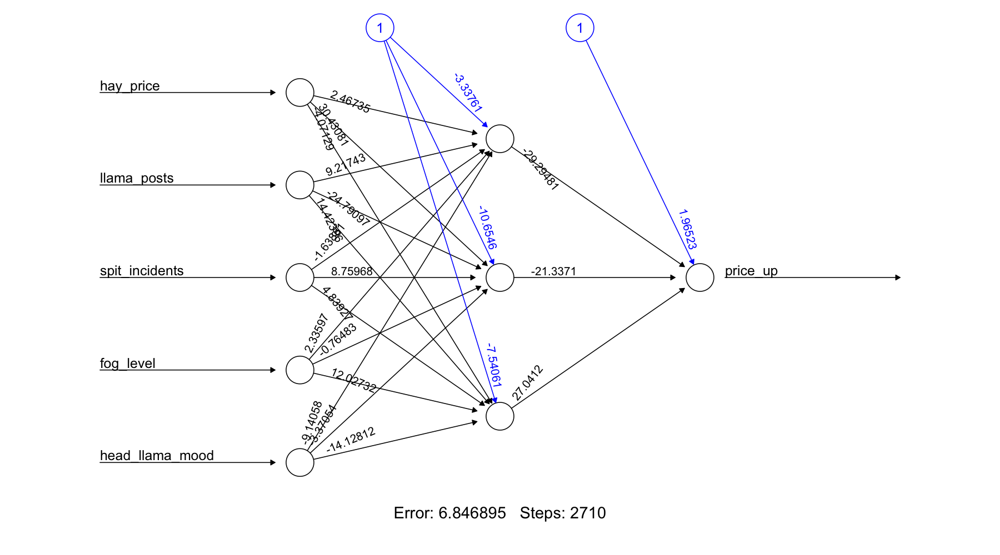
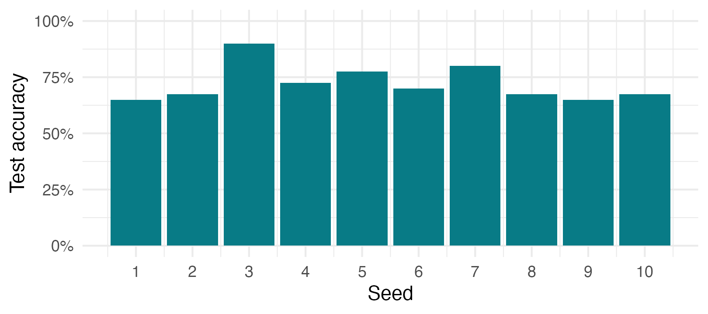

## Llama stocks: same code, different forecasts {.title-slide data-background-color="#10283f"}

CS 301 · Group 6

The Central Bank needs tomorrow’s forecast. Our networks need a group meeting.

::: {.notes}
Presenter 1 · 25 seconds. Our project predicts whether llama-stock prices will go up. The Central Bank needs a forecast, but we want to know whether the network gives a consistent answer. We used our own graph.R and the supplied CSV. We changed the random starts, not the data or architecture. The llamas are fictional; the disagreement is in our results.
:::

## Our data and code

- **160 observations**, split into **120 training / 40 test**
- Inputs: hay price, llama posts, spit incidents, fog, head-llama mood
- Outcome: **price up (1)** or **not up (0)**
- Scale inputs to 0–1; keep split seed **301**
- Train the same network with starting seeds **1–10**

::: {.notes}
Presenter 1 · 35 seconds. These are the exact steps in graph.R. We use five inputs and a binary outcome. For tomorrow, our code uses hay price 6.5, posts 260, spit incidents 4, fog 0.4, and mood 3. Our ten-run experiment keeps the training and test rows fixed. Only the initialization seed changes, so differences across those runs reflect different starting weights. Handoff to presenter 2.
:::

## Our network

**5 inputs → 3 hidden neurons → 1 output**

Original fit: **85% test accuracy · 85.83% training accuracy**

::: {.notes}
Presenter 2 · 40 seconds. This is the original network plot from our graph.R, generated with plot(fit, rep = "best"). We use one hidden layer with three neurons and a logistic output, exactly as our code specifies. The original single model gets 34 of 40 test cases correct, or 85 percent. It gets 85.83 percent correct on training rows. These single-fit results are different from the ten-run average we are about to show. An output above 0.5 is classified as up. Handoff to presenter 3.
:::

## Our ten runs

::: {.run-table}
| Seed | Training error | Test accuracy | Tomorrow: P(up) |
|---:|---:|---:|---:|
| 1 | 7.139 | 65.0% | 37.1% |
| 2 | 6.521 | 67.5% | 0.5% |
| 3 | 6.500 | 90.0% | 73.1% |
| 4 | 6.784 | 72.5% | 6.3% |
| 5 | 6.830 | 77.5% | 48.1% |
| 6 | 6.254 | 70.0% | 8.8% |
| 7 | 6.930 | 80.0% | 46.6% |
| 8 | 7.609 | 67.5% | 2.0% |
| 9 | 7.296 | 65.0% | 40.9% |
| 10 | 7.082 | 67.5% | 49.7% |

:::

Training error is the model’s fitting error, not a percentage.

::: {.notes}
Presenter 3 · 55 seconds. This table answers the overlapping reflection questions about the ten runs and tomorrow’s ten predictions. Seed 3 gets the best test accuracy at 90 percent. Seeds 1 and 9 get the worst at 65 percent. Every tomorrow prediction is shown in the final column. The lowest training error belongs to seed 6, but its test accuracy is 70 percent. So even within our own results, choosing the lowest training error does not identify the highest test accuracy. We should report all starts rather than pick the most flattering row.
:::

## Accuracy depends on the random start

**Worst: 65% · Best: 90% · Mean: 72.25%**

We would report **the mean and range**.

::: {.notes}
Presenter 3 · 40 seconds. This is the test-accuracy plot from our ten-run experiment. The difference between the best and worst run is 25 percentage points. If we must report one number, we choose the mean, 72.25 percent, and include the range for context. All models use the same 40 test rows, so these are not ten independent tests. Different starting weights can lead training to different fitted solutions. The takeaway is that one impressive run does not describe the full experiment. Handoff to presenter 4.
:::

## Tomorrow: mostly agreement, wide variation

**9 “not up” · 1 “up”**

Mean score for a rise: **31.31%**

Range: **0.53–73.06%**

Nine votes out of ten **does not mean 90% confidence**.

::: {.notes}
Presenter 4 · 50 seconds. This answers reflection questions 2 and 5 together. Only seed 3 predicts up when we apply the threshold in our code. The remaining nine predict not up. Their average score is 31.31 percent, but the range is very wide, from about half a percent to 73 percent. We therefore have agreement about direction in most runs, but considerable variation in the model scores. The average is an average model output, not a guarantee about tomorrow. We should tell the Bank both the majority direction and the disagreement. For a five-person group, hand off to presenter 5; for four people, continue.
:::

## The Bank’s statement

> Nine of our ten networks predict no rise tomorrow, but their predictions vary widely, so the Central Bank considers the forecast uncertain.

To improve trust: **report the spread, test more unseen data, and check consistency across starts**.

**The forecast needs a caveat before it gets a microphone.**

::: {.notes}
Presenter 5, or presenter 4 in a four-person group · 55 seconds. This answers reflection questions 3 and 6. Our statement is honest about both the majority prediction and uncertainty. To make the prediction more trustworthy, we would report the average with the spread, test on more unseen observations, and repeat training to check consistency. Our project already shows why this matters: the exact same network structure can produce test accuracy from 65 to 90 percent, and tomorrow’s scores can vary widely. We should not choose one favorable seed and present it as certainty. Our main lesson is that the forecast depends on the starting weights, so the range belongs beside the headline. Total planned time is five minutes.
:::
